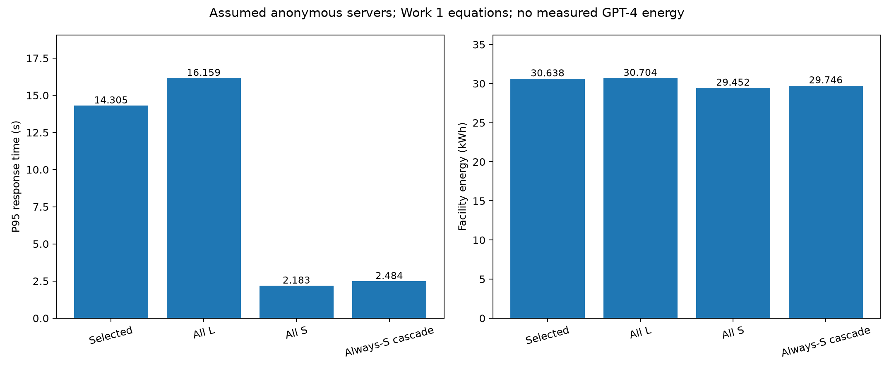
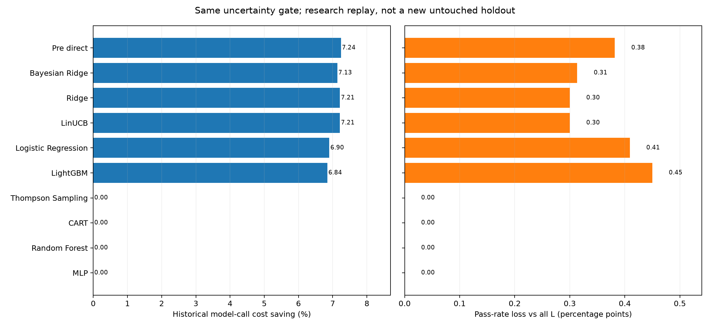

# 第二问完整求解：接入Work 1后的自适应AI路由

本文件对应实际已运行的代码和历史数据回放。所有性能表由本目录CSV计算；原Work 1文件未修改。没有新增付费LLM调用，没有生成假质量标签。合成小样本仅用于软件边界测试。

**当前建议：Pre-LightGBM直接路由＋分任务风险回退。** 本轮最终方案在旧测试集7335个请求上平均Score为0.776142，达标率为83.8173%；相对全L达标率下降0.3817个百分点，历史模型调用成本节省7.2399%。本次四项研究容差是否通过：**是**。

**研究边界必须先说明**：旧验证/测试集已在前面的多轮研究中查看。本轮重新拟合避免了直接训练泄漏，但不能恢复整个项目的“从未看过留出集”。保守风险规则是在初轮失败诊断后补充的；前两轮失败完整保留，最终结果仍需新留出或外部数据确认。95%统计边界依赖下文假设，不是现实服务的95%质量保证。

## 1. 题目究竟要求什么，为什么需要第一问

赛题第二条要求设计并评价一个自适应路由器：在轻量模型、较强模型和额外推理计算之间作选择；利用历史结果学习，认识不确定性，必要时修正不满意的回答，并与简单非自适应方案比较。项目保存的题目页为`task2_complete/docs/question_page2.png`。赛题没有指定0.02、0.05或Score≥0.5等数值标准。

第一问负责“给定请求与模型，预计质量/资源是多少”；第二问负责“这些预测怎样变成模型选择、付费升级和最终交付”。预测误差较小不自动等于路由效果最好，必须按交付质量和完整路径成本评价。

这里的自适应是按当前请求条件分流，不等于每交付一次就必须在线更新参数。历史训练提供学习，离线校准提供安全限制；是否开启在线更新还要另外用实验判断。

本轮实现S、L和S→L三种可观察路径。S为Mixtral-8x7B，L为GPT-4-1106-preview；沿用原配对，不根据测试挑模型组合。升级表示强模型重新回答原请求，不是假定已经获得“参考小模型草稿的定向改写”。同模型增加推理token/重复生成没有配对质量结果，因此没有虚构S⁺收益；程序保留该研究限制。

## 2. Work 1怎样接入，哪些文件不能直接拿来评价

| 第一问材料 | 本轮处理 | 原因 |
|---|---|---|
| Pre-LightGBM与MIRT脚本 | 保留结构、3折交叉拟合和指定参数，按共享划分重训 | 原脚本自己的80/20划分与第二问不一致；未提供可直接对齐的Pre部署权重 |
| 独立IRT分类器与XGBoost比较脚本 | 不将二元IRT概率混成连续Score；本轮Pre限定A/B/C/D四变体 | IRT脚本目标是Score==1；XGBoost未纳入本轮Pre有限搜索，不据此判断其更差 |
| V.joblib/VC_2.joblib | 不将原全量权重用于同批测试；重训V及S/L专用VC₂ | export脚本用全历史MC拟合；原peer是11模型固定next，当前peer是实际S/L |
| 响应时间/环境core.py | 实际调用其服务时间与功率积分函数 | 沿用方程不等于这些系数已由真实硬件测量拟合 |
| task1_cost.py及cost_summary | 接入折旧方程和已有参数/派生电价情景 | API历史USD与假设自建EUR是两种账本，不相加 |
| 脚本中的routerbench_0shot-v2.csv | 使用本机已有且已审计的routerbench_0shot.csv | v2文件没有随材料提供，不能承诺复现未附带的v2数值 |

所有Work 1代码/参数及导出权重均记录SHA256；原脚本中的路径和顶层实验不直接执行，只抽取需要的函数/模型定义，避免硬编码旧路径或全量训练副作用。原函数、参数快照见`work1_source/`，接口适配见`q1_adapter.py`。模型顺序、规范化prompt字符长度等适配均按共享数据重建。

## 3. 数据预处理与信息边界

原RouterBench有36497条请求。安全解析序列化prompt/response列表，按顺序拼接完整上下文；排除80条S/L含多轮回答、超出单轮范围的请求，得到36417条请求和72834条S/L配对结果。所有Score有限且位于[0,1]、历史调用成本有限非负。缺失质量和成本不填零。

按合并空白后的完整prompt计算SHA256，同提示组及其所有模型结果放在同一分区。保留source_row、request_id和benchmark用于回查；oracle列不进入模型。模型输入不能读取当前真实Score、当前回答或当前真实输出长度。训练Pre时可使用历史11模型评分；在线只执行实际选择的S/L，不免费读取其他9份回答。

| 分区 | 请求数 | 用途 |
|---|---|---|
| train | 21822 | 拟合Pre/Post、收益预测器、标准化和成本预测 |
| select | 3615 | 从原验证集分出，选Pre变体、网络检查点及路由阈值 |
| confirm | 3645 | 校准固定候选的风险和回退；最终版本也用于选择回退后的模型成本 |
| test（旧研究留出） | 7335 | 策略冻结后的探索回放，不反向选择具体阈值 |

任务分组沿用第二问Code/Math/General；选择题标记独立于这三个分组，数学MMLU仍可以是选择题。Pre-MIRT的原始能力维度规则将某些computer/machine-learning benchmark视为Code，与第二问评价分组不完全相同，保留原规则作为MIRT输入，不混写两种统计口径。

**部署信息假设**：任务来源/benchmark注册标签在请求到达时已知，因为第一问Pre使用`eval_name`。它不能靠读取当前正确答案获得；未注册任务直接L。本实验没有训练一个“百分之百准确的任务分类器”，不能自动推广到来源未知的开放请求。

## 4. 第一问Pre：先估计两模型质量，再估计升级收益

基础Pre输入为规范化prompt字符长度、任务注册标签和model_id，LightGBM回归原Score。字符数不是模型token数。第一问给定200棵树、学习率0.05、最大深度5，种子42；本轮只把并行线程限制为4。

MIRT增强版沿用分级概率模型：logit由模型在某能力维度的θ减去题目难度b构成，再经分级阈值得到评分等级概率。题目难度只可从训练题评分估计；对新题用LightGBM从字符长度和任务标签预测难度。评分等级按第一问预设的二元/5级/11级方案最近邻量化，属于继承的建模选择，不能说所有原始评分天然具有相同等级含义。

为防止某训练题的真实Score进入自己的Pre特征，外层3折为第二问训练行生成OOF质量预测；每个外层拟合集内再用内层3折生成MIRT增强特征。验证/测试只由全训练集拟合的Pre预测。这比直接把第一问全量预测拼到第二问严格。

| Pre变体 | 选模分区S/L质量RMSE | 质量MAE |
|---|---|---|
| A_Baseline | 0.375901 | 0.304450 |
| B_Ability | 0.376165 | 0.305434 |
| C_Difficulty | 0.376114 | 0.305607 |
| D_Full_MIRT | 0.376391 | 0.304250 |

按预先采用的S/L质量RMSE选择**A_Baseline**。差距很小，不能声称统计显著或MIRT普遍无效；D的MAE还略有优势。这次选择的是评分预测RMSE，不是收益预测RMSE。

得到`q_hat_S(x)`、`q_hat_L(x)`后，直接收益为`g_pre=q_hat_L−q_hat_S`。额外收益预测器则学习真实配对标签`Δq=q_L−q_S`，输入为原冻结MiniLM384维＋8个文本统计量＋三个合法Pre特征，共395维；新增列仅用训练OOF预测标准化。

最终选中的Pre直接路由不需要在实际推断时计算MiniLM或再运行随机森林。复杂候选仍使用同一395维输入进行对比，但不能把其离线预测能力当作必须叠加的理由。

## 5. 第一问Post：为什么必须先付费得到回答

V使用model_id、格式异常、空回答、拒答、硬标记及重复度等原6个特征，250棵树、学习率0.05、最大深度5；只对MC预测Score。VC₂增加实际S/L两份回答的有效选项与一致性特征，训练peer改为本次真正调用的S/L配对。V训练MC回答176792条，VC₂训练S/L回答32144条，均只来自训练请求；训练行另有3折OOF输出。

非MC只提供第一问的任务诊断，例如代码语法、明确标记的数学数值、空回答/拒答；未具备真实语义正确性验证时，质量代理保持缺失。格式正确、答案一致和回归Score均不等于正确率保证。

| Post评估器（S/L） | 分区 | 回答数 | Score MAE | Score RMSE |
|---|---|---|---|---|
| V | confirm | 5368 | 0.366534 | 0.424378 |
| V | select | 5326 | 0.369006 | 0.426694 |
| V | test | 10804 | 0.375296 | 0.433343 |
| VC2 | confirm | 5368 | 0.224611 | 0.327769 |
| VC2 | select | 5326 | 0.228761 | 0.333707 |
| VC2 | test | 10804 | 0.236346 | 0.344618 |

一次实际路径按下式计费：直接S为C_S，直接L为C_L；先S再L为C_S+C_L。只有第二次调用已经发生，才允许使用VC₂比较两份已生成回答；即使最终选回S，第二笔L成本仍要计入。

主策略是否启用V/VC₂由验证数据决定。本轮最终General参数γ为空，Code/Math回退L，所以主策略升级率为0；关闭Post消融与主策略相同。**这说明第一问Post已规范接入并得到评价，但本轮不支持为最优主路径强制开启它，更不能把节省归功于VC₂。** 固定全S级联等对照会实际使用这些模块。

## 6. 第二问决策模型与候选比较

本轮采用质量预算约束下最小化历史模型调用成本的形式。时延与环境影响独立核算并检查后果；由于硬件和控制开销尚未匹配实测，没有用无依据的权重将美元、秒和碳排放混成一个总分。因此不声称已经得到四维资源目标的全局最优。

执行前决策分数为：

$$H(x)=\widehat{\Delta q}(x)+k\,s(x)-\lambdarac{\widehat C_L(x)-\widehat C_S(x)}{c_0}.$$

当H≥任务阈值τ时直接L，否则先S。成本预测用训练集字符长度的非负回归，不能读取当前实际输出长度；c₀是训练L成本预测均值。s是模型分歧，未作覆盖率校准；Pre直接路由没有该分歧项。

对各任务分别搜索τ的41分位点及全S/L端点，λ取0/0.5/1；有分歧的MLP/RF搜索k=0/0.5/1。Post阈值为关闭/0.25/0.5/0.75/1.01；启用后，MC低V或非MC硬异常可触发升级，并比较“直接保留L”与“VC₂选回答”。这些是有限网格的研究选择，不是连续最优性证明。

| 候选 | 实现 |
|---|---|
| Pre_direct | 直接使用第一问两模型预测差；不增加收益学习器 |
| Ridge / Bayesian Ridge | 线性收益回归；Ridge正则10/100在select选，Bayesian默认证据估计 |
| Logistic Regression | 9个离散Δq值的多项分类，输出Σp(Δq)Δq，C=0.01 |
| CART / Random Forest | 深度4单树；200树RF，深度12、叶节点至少20、max_features=0.5 |
| Gain-LightGBM | 400轮上限、学习率0.03、31叶、最小叶样本50，select早停30轮 |
| MLP | 64/16隐藏层、L2=0.01、学习率0.0003，3种子、最多80轮、select早停 |
| LinUCB / Thompson Sampling | 训练S/L独立线性质量模型暖启动；L2在1/10/100选，探索/后验尺度1，TS重复5次 |

LinUCB暖启动两动作使用完全相同上下文，冻结状态下不确定性加成抵消，因此接近Ridge；不能把本表当作其在线探索优势的证据。Thompson Sampling采用线性高斯工作后验，属于研究近似，不是二项正确率模型。

### 6.1 为什么增加风险回退，前两轮失败是什么

第一轮在每任务select均分/达标率损失≤0.01后最小化成本，选中Ridge。按confirm点估计回退Code后，旧测试Math达标率损失仍为2.28个百分点，失败数值保留在`Selected_protected`行（旧阶段目录已清理）。

第二轮补充固定策略配对bootstrap上限，选中Gain-LightGBM；但Code校准只有43组，零观察损失的普通bootstrap可能给出零宽区间，旧测试Code损失3.49个百分点，仍失败，数值保留在`Selected_uncertainty_guard`行（旧阶段目录已清理）。它们没有被删掉或改写为通过。

最终改进不是根据测试题名单打补丁，而是对所有固定候选统一处理零事件、小样本与多重比较；仍属于看到前面诊断后的补充研究，不能包装成新的独立确认。

### 6.2 最终风险规则及其数学含义

对安全校准分区的每个独立prompt组，定义：`h=1{全L达标、实际交付不达标}`，组内多条记录取最大；另外定义`z=max(q_L−q_final,0)`，同组及TS预设轨迹取最大。净达标率损失不超过有害事件率，净均分损失不超过正向损失均值，所以忽略反向改善是保守的。

$$U_h=\operatorname{Beta}^{-1}(1-lpha;h+1,n-h),$$

$$U_q=ar z+\sqrt{rac{2s_z^2\ln(2/lpha)}{n}}+rac{7\ln(2/lpha)}{3(n-1)}.$$

U_h为Clopper–Pearson单侧上界，h=n时为1；U_q为经验Bernstein上界并截断到[0,1]。零事件时U_h=1−α^(1/n)，不会因为观察到零次损失就把未来风险写成零。参考[精确二项区间](https://docs.scipy.org/doc/scipy/reference/generated/scipy.stats._result_classes.BinomTestResult.proportion_ci.html)与[经验Bernstein定理4](https://arxiv.org/html/0907.3740)。

本轮10个固定家族×3任务×2指标，共60个边界，整体研究α=0.05，逐边界α=0.00083333。Code只有43组，即使零事件也无法凭该样本量支持2个百分点的尾部损失门槛，因而回退L。组内重复请求增加一个按已知输入计数计算的保守重复质量上界修正；未来重复比例不得无条件超过声明上限。

每个模型枚举三个任务是否回退L的8种组合。回退L相对全L的损失由动作相同而严格为零，不是从零错误样本外推。其余任务要求上界分别不超过任务均分0.05、达标率0.02；再按声明的任务混合权重检查总体上界不超过0.02。只在符合者中比较select历史调用成本，最后选择成本最低的家族。

Code回退主要受极小校准样本限制；Math回退还涉及正向均分损失上界和总体质量预算，不表示数学预测一概无效。即使只剩少数Math可分流，其潜在节省也未必值得占用保守风险预算。

**边界假设**：同一注册任务内prompt组近似独立、可代表未来需求，固定候选与校准数据独立，未来任务混合及重复比例在声明范围内。本项目已经反复利用旧数据，Bonferroni不能消除整个项目的反复试验偏差；这些边界是保守实验设计与诊断，不是本数据上的无条件生产保证。

## 7. 实际模型对比与最终选择

下表对所有家族使用同一最终风险规则。“全部L”表示该候选缺乏足够证据支持小模型分流，而非宣称该模型本身没有价值。选择依据是上一节的验证成本，不能从测试表重新挑赢家。

| 家族 | 风险回退任务 | 测试平均Score | 测试达标率 | 模型调用节省 |
|---|---|---|---|---|
| Pre-LightGBM直接路由 | Code,Math | 0.776142 | 83.817% | 7.240% |
| Bayesian Ridge | Code,Math | 0.776789 | 83.885% | 7.134% |
| Ridge | Code,Math | 0.776926 | 83.899% | 7.211% |
| LinUCB | Code,Math | 0.776926 | 83.899% | 7.211% |
| Logistic Regression | Code,Math | 0.775937 | 83.790% | 6.902% |
| 额外Gain-LightGBM | Code,Math | 0.775494 | 83.749% | 6.844% |
| Thompson Sampling | Code,General,Math | 0.780641 | 84.199% | 0.000% |
| CART | Code,General,Math | 0.780641 | 84.199% | 0.000% |
| Random Forest | Code,General,Math | 0.780641 | 84.199% | 0.000% |
| MLP | Code,General,Math | 0.780641 | 84.199% | 0.000% |

最终选择**Pre-LightGBM直接路由**，回退任务为**Code, Math**。General使用：

$$H=\widehat q_L-\widehat q_S-0.5(\widehat C_L-\widehat C_S)/c_0,\qquad 	au=-0.6170992537.$$

General中H≥τ直接L，否则S；Code/Math直接L。这个负阈值仅对本次归一化和数据成立，不是普适常数。未注册来源也直接L。

### 7.1 与简单方案的比较

| 策略 | 平均Score | 达标率 | 调用次数/请求 | 历史USD/千请求 | 成本节省 |
|---|---|---|---|---|---|
| 全L | 0.780641 | 84.199% | 1.000 | 3.22199 | 0.000% |
| 全S | 0.547648 | 56.864% | 1.000 | 0.13313 | 95.868% |
| 固定先S后检查 | 0.743422 | 76.442% | 1.740 | 1.36053 | 57.774% |
| 随机匹配最终验证L调用率 | 0.767451 | 82.656% | 1.000 | 3.04476 | 5.501% |
| 最终方案 | 0.776142 | 83.817% | 1.000 | 2.98872 | 7.240% |

随机方案按最终方案的select L调用率设预算，重复10次并取均值，不挑最好种子，也不保证测试实现的USD成本完全相同。固定先S级联虽然调用更多，质量仍不满足目标；有额外计算不等于有足够的有效纠错。

| 最终方案任务 | N | 平均Score损失 | 达标率损失/百分点 | 该任务调用节省 |
|---|---|---|---|---|
| Code | 86 | 0.000000 | 0.0000 | 0.000% |
| General | 5539 | 0.005958 | 0.5055 | 17.357% |
| Math | 1710 | 0.000000 | 0.0000 | 0.000% |

最终有431个请求进入S，其余进入L；净少28个达标请求。Code/Math质量与全L相同源于保护路径；General承担了有限的成本—质量取舍。

固定策略、同prompt组配对bootstrap的95%区间：总体均分损失[0.001873, 0.007191]；达标率损失[0.0955, 0.6681]个百分点；调用成本节省[6.434%, 7.969%]。这些是描述性区间，不含训练/选择和硬件误差。

### 7.2 为什么接入后不再推荐额外Random Forest

此前推荐RF的实验只有文本表示和较宽的总体容差；这轮新增了第一问的任务条件质量预测、更严格的分任务证据边界及独立用途的校准分区。不能把两轮差异全归因于某一个模型。

第一问已给出两个模型的条件质量，直接相减就能形成有效升级收益。额外RF的收益预测误差可能较小，但若它分流的请求缺乏风险证据，保护后就必须回退L，不能按原分流节省率当作可采用收益。本轮有限候选中，直接Pre路线验证成本最低且推断结构更简单；这不是“LightGBM在所有任务上普遍最好”的结论。

前几名的验证成本差距很小，尚无稳定家族优劣证据；测试表也可能有别的模型更省，不能因此换掉验证选出的赢家。最终选择还没有计入未知的真实控制开销。

可比较的RF增量消融使用相同200/depth12/leaf20/max_features0.5、相同新Post和相同select阈值原则：

| 未加最终风险回退的RF消融 | 平均Score | 达标率 | 调用节省 | 四项容差通过 |
|---|---|---|---|---|
| RF无Pre | 0.772631 | 83.340% | 12.168% | False |
| RF接Pre | 0.773177 | 83.381% | 12.947% | True |

该消融表明Pre能改变质量—成本工作点，但不是免费的全面改善；两者阈值分别在相同验证原则下选择，所以它不是只增添一个输入而保持路径不变的因果实验。关闭最终主策略Post和VC₂的消融与主结果相同，不能宣称这些模块贡献了本轮主策略收益。

## 8. 第一问时延、环境和经济成本的完整接入

资源表全部标为assumed情景。对RouterBench自身回答计算正则长度代理l、o，再调用Work 1服务方程，x=l/1000、y=(o−1)/1000：

$$T_{first}=0.05+0.2x+0.01x^2,\quad T_{decode}=8y+0.1xy+0.02y^2.$$

均值为1的对数正态扰动σ=0.15保持TTFT与decode配对。S服务倍率1，L倍率1/2/3作敏感性，主表倍率3是新增假设；DGX B200反事实整机功率模型设共享功率1500W、每张空闲GPU 175W、忙碌GPU 760W、PUE1.2；每个S/L服务器池单独对应一台始终开机的8-GPU设备，未证明匹配Mixtral/GPT-4。GPT-4硬件未知且不能假定部署在DGX上，所以这是匿名后端的资源反事实，不是GPT-4真实用电估计。

只复用第一问Azure code前7335条到达间隔的形状，将RouterBench请求按固定随机顺序放入该形状并缩放到参考L池负载0.6；没有把Azure的长度/质量与RouterBench行号拼成同一真实请求。每种策略使用相同需求和请求，S/L各有独立FCFS池，副本数1/2，需求倍率0.5/1/2，重复3次。

升级L任务在S实际完成且完成检查后才进入L队列，不能把两次调用并行算成一次时延。所有方案在同一场景使用相同观察窗口，两个模型池空闲电量都计入，包括全L时未使用的S池：

$$E=rac{\mathrm{PUE}}{3.6	imes10^6}\left[2(P_{shared}+8P_{GPU,idle})H+(P_{GPU,busy}-P_{GPU,idle})\sum_jT_j
ight]+E_{control}.$$

另假设每请求路由0.01秒、每次Post/VC₂检查0.002秒、控制增量功率10W，并做0.01/0.1/1/5秒和10/30/80W敏感性。实际编码/路由/检查开销未知，不能把这些情景值写成测量值。碳因子沿用第一问EEA EU27 2024的183.44 gCO2e/kWh年度发电温室气体边界，不解释为实时边际减排。

### 8.1 两种费用账本为何必须分开

历史API账本来自RouterBench的`|total_cost`，用于路由选模。假设自建账本为设施电费＋占用窗口折旧，按第一问515000 USD整机参考价、汇率0.90、每抽象副本分摊1/8、5年寿命计算；这些价格/分摊是未核实或人为设定的情景，不是GPT-4的采购配置。

原始Energy-Charts分时价格文件未提供；本轮只从Work 1的DE-LU、负载1、副本1已算结果推导平均0.091092 EUR/kWh，并在新情景中固定。它不是当前零售电价，也没有伪造分时电价曲线。API历史USD与该假设自建EUR绝不相加。

主资源情景（L倍率3、需求倍率1、每模型池1副本）重复3次的均值：

| 策略 | 假设P95/s | 假设设施kWh | 假设gCO2e | 假设自建总EUR |
|---|---|---|---|---|
| 最终方案 | 14.3052 | 30.638127 | 5620.258 | 13.7961 |
| 全L | 16.1594 | 30.703745 | 5632.295 | 13.8021 |
| 全S | 2.1826 | 29.451789 | 5402.636 | 13.6880 |
| 固定先S级联 | 2.4839 | 29.746402 | 5456.680 | 13.7149 |

仅在这一假设主情景，最终方案P95比全L低11.47%，设施电量低0.214%，假设自建总费用低0.0433%。这些条件仿真比例不能改写成实测改善，也不能用7.24%的API节省替代它们。

同基础设施/观察窗口意味着折旧和空闲底座相同，减少API调用支出不一定等比例减少总电量或自建费用。S回答可能更长，S池也可能排队，所以便宜不自动等于更快。需求与容量联合优化属于下一问扩展，本轮资源表检验后果而未声称已经优化所有队列。



历史调用节省给出的新增控制成本上限约为**0.00023327 USD/请求**，即每千请求0.23327 USD。实际额外控制/评审费用超过此值就没有净财务节省；现在没有实测净收益或实测减排。

## 9. 历史反馈实验：为什么默认不启用自动更新

训练Pre和收益模型已经利用历史结果。为另外研究在线反馈，按prompt组随机分10批，当前批先交付，再随机审计约10%的组，补调用缺失的S或L并计费。得到两动作可靠Score后才更新任务残差偏置：累计(真实Δq−基础预测)/(200＋审计样本数)，裁剪到±0.1；阈值、Pre/Post及编码器保持冻结。200、10%、10批和0.1都是研究参数。

评分即时可靠是基准回放假设，现实没有免费正确答案；评审成本和延迟未知。审计不改变已交付回答，不能把补调用结果免费选成更好的交付。更新后的策略也不再自动享有固定策略的校准边界，部署前需重新校准。

| 三次重复的均值 | 平均Score | 达标率 | 模型调用节省 |
|---|---|---|---|
| 冻结策略＋同样付费审计 | 0.776142 | 83.8173% | 5.9923% |
| 批后残差更新＋付费审计 | 0.775869 | 83.7900% | 5.9783% |

本次更新没有显示稳定质量改善，审计还消耗了调用节省，因此主策略默认关闭在线更新。这是实际保留的负结果，不能因为题目提到学习就预设“在线学习一定更好”。

## 10. 为什么会得到这些结果

第一，Pre提供了不同模型在注册任务上的条件评分，简单差值已经有决策价值；第二，质量约束和置信证据限制了可以安全分流给S的比例；第三，Code/Math回退保护了这些任务，但也牺牲了调用节省；第四，General中的成本差异使少量有选择的S调用仍有收益。模型名称或网络复杂度不是优化目标。

最终节省较集中的数据子集如下，仅用于解释既有路径，不允许按测试Benchmark名单修补策略：

| Benchmark | N | 交付S数量 | 历史USD节省 | 净少达标 |
|---|---|---|---|---|
| mmlu-professional-law | 308 | 150 | 0.506225 | 26 |
| bias_detection | 58 | 47 | 0.400751 | 8 |
| consensus_summary | 74 | 61 | 0.207092 | -14 |
| mmlu-high-school-world-history | 48 | 40 | 0.143815 | -1 |
| mmlu-high-school-us-history | 42 | 38 | 0.129140 | 2 |
| abstract2title | 52 | 34 | 0.122913 | 0 |
| mmlu-high-school-european-history | 33 | 32 | 0.116694 | 3 |
| mmlu-security-studies | 49 | 15 | 0.039837 | 2 |

第五，Post格式/一致性特征不等于真实正确性，额外调用有时无法恢复足够质量，所以它在可选模块比较中没有进入最终主路径；第六，资源账本还受输出长度、排队、持续开机空闲与折旧影响，不能把API节省百分比当成能耗下降百分比。



## 11. 假设、选择和未知量总表

| 项目 | 性质 | 对结论的影响 |
|---|---|---|
| 原Score及历史USD | 真实历史记录；异质Benchmark口径 | 不称统一现实正确率、当前API价格或生产效用 |
| S/L候选与单轮范围 | 继承的研究范围 | 没有证明11模型全局最优，也未评价真正额外思考动作 |
| Score≥0.5；0.01/0.02/0.05容差 | 研究偏好，非赛题给定 | 必须随应用需求改变并重验证，不靠改阈值掩盖失败 |
| 已知注册任务元数据 | 部署假设 | 未知来源直接L；没有证明跨任务外推 |
| MIRT分级方案、网络和网格参数 | 第一问继承/本轮实施选择 | 有限比较，非理论最优 |
| 置信α=0.05及组独立/任务混合 | 统计建模假设 | 对漂移、整个项目反复试验、真实正确性不提供保证 |
| 服务方程、σ=.15、L倍率1/2/3 | 假设场景，未匹配S/L硬件 | 不能声称真实GPT-4/Mixtral时延、能耗精度 |
| 1500W共享、175W/GPU空闲、760W/GPU忙碌、PUE1.2、控制10W | 整机功率代理假设 | 两台常开8-GPU服务器的条件核算，不是实测 |
| Azure到达形状与RouterBench任务映射 | 跨数据源反事实 | 不冒充真实同请求配对或整周生产代表样本 |
| 515000USD、0.90汇率、1/8份额、5年 | 未核实价格/资源分摊/折旧假设 | 假设自建EUR与真实API历史USD分开 |
| 派生固定电价 | 从第一问结果派生的新情景输入 | 缺原始价格序列，不声称逐时价格或当前账单 |
| 反馈评分在批后可得、审计10% | 受控回放假设 | 评审成本/延迟未知，主策略不启用更新 |
| 真实控制成本、端到端时延/能耗 | 没有测量，actual字段留空 | 只能给条件情景和开销盈亏上限，不能给净实测收益 |

## 12. 验证到底证明了什么

集成验证总状态：**True**。以下为实际运行检查：

| 检查 | 通过 | 证据摘要 |
|---|---|---|
| 源数据与划分 | True | requests=36417；paired_labels_checked=72834；arrival_prefix_checked=7335 |
| Pre/Post交叉拟合来源 | True | prediction_rows=749260 |
| 395维特征与7个保存模型 | True | features=395；new_model_predictions_reproduced=7 |
| V/VC₂保存模型复算 | True | answers_checked=200 |
| 全部逐请求质量/成本账本 | True | ledger_rows=432765；strategies=33 |
| 付费审计反馈账本 | True | feedback_ledger_rows=132030；batch_logs=180 |
| 排队、能量及会计恒等式 | True | conditional_scenario_rows=378；primary_call_rows=56775 |
| 新请求接口与未知任务回退 | True | fresh_Pre_route_examples=4 |

另有9项合成软件边界测试，覆盖不可免费使用peer、MC缺失代理拒绝、非MC诊断不伪装质量、双调用成本、实际S完成后入L队列，以及零事件置信上界非零。合成数据从未进入性能结果。

这些检查证明数据来源、OOF信息边界、模型保存/回放、调用账本、队列和能量/会计恒等式一致，不证明现实硬件参数准确、未来需求分布不变或总系统必然减排。

验证分区按Benchmark作固定配额划分，并非严格i.i.d.抽样；统计边界使用“同任务内近似可交换”的工作假设。预算只约束Code/Math/General三大类，不能保证General内部每个稀有Benchmark或每个请求都不受损，详见`selected_by_benchmark.csv`。

## 13. 如何运行与接入真实请求

完整新实验应使用新输出目录，原结果不覆盖：

复现依赖已有`task2_router/data`配对预处理、原MiniLM `features.npy`与本地Work 1材料；这些均有来源哈希。缺少缓存需先运行原预处理/编码流程。最终选中的线上Pre直接路由本身不需要MiniLM编码，但本轮多模型对照使用了该缓存。

```powershell
python -B task2_complete/run_all.py --source-project D:/EuroMCM/EuroMCM-project --out task2_complete/runs/integrated_new
```

只查看一个新请求的初始路由，不调用LLM API：

```powershell
python -B task2_complete/predict.py --benchmark hellaswag --prompt "Choose the best continuation."
```

`IntegratedRouter.route()`提供初始S/L；实际执行S后才调用`check_small()`；实际获得S和L两份回答后才调用`choose_after_upgrade()`。接口没有生成假回答、自动付费调用或免费读peer。未知任务和风险保护任务直接L，输出不宣称绝对质量保证。

主要文件：`quality_cost_comparison.csv`全部原始/保护策略；`finite_sample_family_comparison.csv`最终验证选模依据；`by_task.csv`分任务；`pre_selection.json`第一问变体选择；`pre/post_predictions.csv.gz`与provenance为OOF证据；`resource_scenarios.csv`378行情景；`feedback_comparison.csv`审计实验；`decisions.csv.gz`逐请求路径；`verification.json`核验；最终比较表保留早期失败数值，旧阶段快照已清理；`source/`与`work1_source/`保存代码依据。

## 14. 应怎样表述最终结论

在已知任务来源、共享历史配对数据和本轮研究质量预算下，推荐第一问Pre-LightGBM直接路由并对Code/Math保守回退L。旧测试上用0.382个百分点达标率代价换取7.24%历史调用成本下降。结论支持一个可复现研究原型，尚不支持无需新数据和实测开销就直接宣布生产净收益或实测减排。

下一步最有价值的证据是新的独立请求集、更多代码/数学校准样本、同请求实际LLM token/时延/服务器功率及控制成本。若这些证据表明收益不足，采用更简单或全部L的策略也是合理结果。
